# Along 本地 Agent 系统架构

> v0.6 目标架构，2026-11-16 核对状态。已实现范围见 [实施与验收](003-implementation.md) 第 1 节；本文仍包含后续设计，不代表全部能力已完成。决策依据见 [决策记录](000-decisions.md)，记忆与技能见 [记忆与技能](002-memory-and-skills.md)，阶段与验收见 [实施与验收](003-implementation.md)。原型现有实现以 [007 Architecture](../007-architecture.md) 为准。

## 1. 目标与边界

围绕用户的长期目标，持续理解用户对话和授权健康摘要，由 Agent 自动维护目标与动态任务，用户通过聊天纠正（D3）。服务不应每收到一条健康更新就重新规划，也不能靠不断变长的模型会话保存用户的一切。

主链路：**事件触发 → 筛选 → Agent 判断 → 程序校验 → 自动写入目标与任务 → 同步到手机 → 用户通过聊天继续纠正。**

建目标以明确行动意图为前提（D11）：「我想改善睡眠」可自动建立目标；「最近睡得不好」先回应，缺少意图才询问，不把现象直接转成目标。意图明确后不增加采用或确认环节。

首期是自用 DEMO（D1）：Mac 保存业务状态并运行 DSH，iPhone 提供聊天与健康摘要。不做外部用户注册、公网接入、跨机器调度、计费和多租户运维。理财仍只用演示数据。首期不做额外的健康授权撤回及关联历史数据清理流程（D15），不设应用侧每日预算或累计模型用量上限（D17）。

本地服务不等于模型本地运行：允许分享的摘要和必要上下文仍会发给所配置的模型供应商。

Mac 休眠、关机或手机连不上 Mac 时无法即时处理。手机先保留待同步内容，连接恢复后补传。服务端不能唤醒手机或读取最新 HealthKit，因此不新增服务端「到期复查事件」；App 已有的提醒与后台机制保留。

## 2. 对象

| 对象 | 回答的问题 | 示例与边界 |
| --- | --- | --- |
| Goal，用户目标 | 用户想达成什么 | 「每周运动 120 分钟」。Agent 根据对话总结并决定，自动创建、修改、归档；用户只能通过聊天改变它（D4） |
| UserTask，用户任务 | 用户接下来做什么 | 「今晚散步 20 分钟」。动态生成和调整，有版本和完成反馈 |
| Conversation，业务对话 | 围绕目标说过什么 | 用户原话、系统答复、自动变更说明、用户纠正 |
| Memory，用户记忆 | 关于这个人的什么信息可以长期复用 | 偏好、长期约束、带期限的情境；必须有来源与适用范围 |
| Ticket，DSH 工单 | Agent 正在处理哪项工作 | 「根据出差安排重排本周运动」；一次工作可能生成多项 UserTask |
| Assignment，DSH 派工 | 这项工作本轮由谁执行 | 同一 Ticket 可经历多次派工、等待与恢复 |
| Skill，可复用方法 | 同类工作下次怎样做 | 根据进度和约束调整任务的方法，不含用户私人事实 |

UserTask 不等于 Ticket，Goal 也不等于一个永不结束的 Ticket。业务对象用稳定的 `goal_id`、`task_id` 关联，执行对象通过 WorkLink 映射到它们；业务历史不依赖某个 DSH Session 是否还在或是否被压缩。

## 3. 进程与模块

1. [系统总览：iPhone、Mac 上的进程与持久化](../../.archify/architecture-along-layers-20261115-015123/along-system.html)
2. [DSH 内部：接入、编排、Worker、业务服务与学习](../../.archify/architecture-along-layers-20261115-015123/along-runtime.html)

| 进程 | 职责 |
| --- | --- |
| Along Host（现有，Node） | 手机入口：配对、接收、查询、同步与输出校验。只调用本机接口，不直接读写业务库 |
| DSH（Along Agent） | Along Source、Router / Engine、Worker、Along 业务服务和定时批量作业都在这个进程内；业务服务独占 `along.sqlite` |
| Hy-Memory（Python） | 记忆提取与召回，只供本机访问（D6） |

DSH 管理端不暴露给 iPhone。手机只持有配对凭证；模型 Token 和 DSH 管理凭证留在 Mac。进程间接口在阶段 A 确定。

## 4. 事件接入

### 4.1 一个 Source，三类事件

新增 `source = along`，业务类型映射到 Trigger 的 `meta.event_type`，不写进 DSH 通用核心。

| `event_type` | 内容 | 处理原则 |
| --- | --- | --- |
| `along.user_message` | 用户发给助手的消息：新目标、修改目标、约束、纠正 | 先保存原文；明确请求必须得到答复或明确的失败状态 |
| `along.health_summary_updated` | 授权范围内的汇总值、窗口、时区与版本 | 先保存最新有效摘要，再判断是否值得唤醒；不发送原始样本 |
| `along.message` | 有明确业务含义的非聊天消息 | 用受控的 `kind` 分派，不能成为任意控制命令的入口 |

`along.message.kind` 首期业务使用 `task.completed`、`task.feedback`。阶段 0 的 Source descriptor 还识别 `authorization.changed`，但首期不实现对应的健康授权撤回业务（D15）。目标只能通过聊天改变（D4），客户端不上报目标变更；目标的每次变化都来自 Agent 提交的 ChangeSet。

`task.feedback` 附带的说明如果本身要求助手处理，用同一 `message_id` 关联对话，不当作两次请求。系统自己写下的回复、执行报告和复盘只落业务记录，不重新进入入口，避免「系统回复触发系统回复」。

`task.completed` 是完成事实：服务端把任务状态改为 `done` 并推进任务版本，随后发出带 `goal_id` 的 `task_updated` 同步项，客户端据此刷新目标快照、显示「已完成」。没有这条同步项，手机只会保留旧快照，看不到完成结果，刷新后也不会保留。带每日安排的周期任务走「完成本次并续排」：任务仍为 `open`，同步项的 `status` 为 `open`。

同一条任务的完成事实只生效一次：已经是 `done` 的任务再收到完成事实（例如手机同步失败后重试），只留下消息记录，不再推进任务版本，也不再发第二条 `task_updated`——一个任务只有一个完成版本、一条对应同步项，执行次数不累加。周期任务由触发器按周期去重，同一周期内的重复确认不产生第二次续排。

目标快照有界：它最多带 200 条任务。历史任务里更早的已完成任务按需翻页读取（`GET /tasks` 带 `goal_id` 与游标），不放大每次同步的目标快照。

### 4.2 事件信封

拟议协议，实现前用 Schema 固化。

| 字段 | 含义与可信边界 |
| --- | --- |
| `event_id`、`schema_version` | 客户端稳定事件号与协议版本；重试使用同一事件号 |
| `event_type`、`kind` | 事件类型与通用消息子类型 |
| `user_id`、`device_id` | 服务端从配对会话绑定，不信任请求体自称的身份 |
| `goal_id`、`task_id` | 业务对象关联，服务端检查归属 |
| `occurred_at`、`received_at`、`timezone` | 发生时间、接收时间、业务时区 |
| `message_id`、`causation_id` | 关联原消息或前置事件，用于追踪与防循环 |
| `base_revision` | 提交时看到的业务版本，用于检测过时写入 |
| `payload` | 文本，或健康摘要的引用、版本和窗口；内容是数据，不是授权 |

健康同步事件可以不带 `goal_id`：按用户接收一次，由服务端找出相关目标；没有目标时也不丢弃数据。

### 4.3 可靠接收与补传

手机先保存待同步事件。服务端在一个事务里写入事件 Inbox、必要业务记录和待投递记录后，才返回持久接收回执；收到回执后手机才删除本地待同步项。

Inbox 按用户和 `event_id` 去重，同号不同内容返回冲突。业务库与 DSH 库之间不假设分布式事务：待投递记录至少一次送入 DSH，DSH 按稳定的 Trigger id 去重。

「模型输出完成」「业务变更已生效」「手机已收到」分别记录。手机离线不阻塞自动生效，结果留在服务端，重连后取回。

### 4.4 健康数据范围

首期沿用 [HealthKitReader](https://github.com/artstur/Along/blob/main/ios/AlongHealth/Sources/HealthKitReader.swift) 已读取的 7 类与现有口径（D5），窗口与字段见 [ios/README](https://github.com/artstur/Along/blob/main/ios/README.md)。原始样本留在手机，服务端只收汇总。

| 类型 | 变化语义 | 筛选时怎样比较 |
| --- | --- | --- |
| 步数、活动消耗、健身记录 | 窗口内累计 | 同一窗口内与上次已评估值比较；跨窗口重置不是负进度 |
| 体重、静息心率、睡眠期间手腕温度 | 最近值或期间均值 | 按读数版本比较；补传的旧读数不覆盖新状态 |
| 睡眠 | 按夜汇总 | 按睡眠日比较；当晚尚未结束时不当作缺睡 |

协议为扩展留位：每份摘要带类型标识、单位、统计方法、窗口、时区、版本和摘要器版本。服务端遇到未知类型标记为待适配，不作为可信模型上下文。以后加类型只加手机侧摘要器和服务端的类型说明，不改事件协议。

区分无权限、不可用、未同步与实际为零。HealthKit 不让读取方区分「没有记录」和「拒绝读取」，不据此推断授权状态。

## 5. 存储

### 5.1 实体

逻辑模型，不要求每行都独立成表。

| 实体 | 最少保存什么 | 核心规则 |
| --- | --- | --- |
| Goal / GoalRevision | 标题、指标、状态、版本、来源消息 | 只由 Agent 的 ChangeSet 修改 |
| UserTask / TaskRevision | 所属目标、内容、状态、计划时间、版本、生成依据 | 未收到完成反馈不记为未完成 |
| Message / MessageGoalLink | 原文、角色、时间、顺序、目标关联、回复关系 | 按目标查完整对话；一条消息可关联多个目标而不复制正文 |
| ChangeSet | 操作、原因、基准版本、触发事件、提交状态 | 校验后原子提交；状态只有 applied / conflicted / invalid，没有待批准 |
| HealthSummary | 汇总值、窗口、时区、版本、授权范围 | 区分无权限、不可用、未同步与实际为零 |
| Memory / MemoryRevision | 内容、范围、证据、明确或推断、有效期、状态 | 治理状态以这里为准；提取与召回由 Hy-Memory 完成 |
| EventInbox / Delivery | 原事件、接收结果、筛选与投递状态、幂等键 | 先可靠接收，再推进后续执行 |
| WorkLink | Goal、UserTask、事件与 Ticket / Assignment 的对应 | 业务 ID 与执行 ID 独立 |
| RunRecord / Reflection / SkillVersion | 执行记录、批量复盘结果、技能版本 | 执行记录在 Worker 结束时登记；复盘由批量作业生成 |

完整对话指用户与系统实际交换的内容，不是模型隐藏推理。DSH 工具轨迹和子 Agent 对话作为执行记录另存。

### 5.2 权威数据源

- `along.sqlite` 是目标、任务、对话、变更、健康摘要和记忆治理状态的权威来源。
- DSH Store 是 Trigger、Decision、Mandate、Ticket、Assignment 和 Effects 的权威来源。
- Hy-Memory 保存提取出的记忆和索引。召回结果要按 SQLite 中的治理状态再过滤，两者不维护互不核对的用户画像。
- 手机本地存储只做离线缓存、待同步队列和展示；冲突按版本处理，不静默双向覆盖。
- 会话摘要、FTS 和向量索引都是可重建的派生数据。

所有业务写入走同一服务层。数据目录放在 Mac 的 Along 状态目录下，并且不在 Worker 工作目录内（见 §8.1）；具体路径实施时核对现有配置，本轮不迁移 `~/.along/agent-host/`。

### 5.3 按目标保存完整历史，按需装配上下文

目标详情按服务端顺序分页读取消息与变更。补传消息不能仅凭客户端时间重排已确认的因果关系。

Context Builder 给模型的上下文：目标当前版本、当前任务、近期相关消息、带引用的阶段摘要、适用记忆、最新有效健康摘要与本轮事件。需要更多证据时，Worker 按消息 ID 分页读原文。

现有前端对话最多保留最近 20 条、提交最多带 12 条。新链路从接收每条消息时开始完整保存；旧版本已删除且无备份的消息，迁移时不凭摘要或模型推测恢复原文。

### 5.4 删除与备份

用户要求删除记忆时，治理状态立即置为撤回，检索立即排除；派生索引与 Hy-Memory 内的数据由批量作业清理，清理前召回结果也会被过滤掉。

「忘记这件事」不删除历史聊天（D13），原文仍可供用户查看。Context Builder、阶段摘要与批量记忆提取必须核对撤回记录，不能因旧聊天仍在而继续使用或重新提取已撤回的记忆；旧事件重放也不能使它复活。忘记偏好不自动取消目标或重排已有任务；后续规划不再使用该偏好。用户明确要求修改相关安排时，再提交新的 ChangeSet（D16）。

备份覆盖业务库、DSH 状态、技能版本和 Hy-Memory 数据目录、索引与配置。用协调停写或各存储支持的一致性备份，不直接复制正在写入的 SQLite 文件。

## 6. 筛选：先保存事实，再判断是否值得行动

### 6.1 三个判断分开

1. **能不能接收**：身份、Schema、归属、授权范围。
2. **值不值得唤醒**：新信息是否可能改变当前判断。
3. **获准做什么**：DSH Gate、Policy、Mandate 加上 Along 写入校验。

「不值得唤醒」不丢弃用户原话或最新有效摘要。

### 6.2 筛选顺序

| 层次 | 判断 | 输出 |
| --- | --- | --- |
| 接收校验 | 配对、Schema、事件号、归属、授权 | 持久接收、重复回执或明确拒绝 |
| 确定性筛选 | 摘要版本、窗口、有效性、变化量、当前计划和在途工作 | `record_only`、`coalesce`、`evaluate`，记录原因与规则版本 |
| 语义评估 | 原消息、事实、记忆、当前目标与已有工作 | 答复、询问、继续已有工作或新建工作 |

用户请求、纠正和任务反馈不受健康数据冷却或限流影响。健康授权撤回流程不在首期实现与验收范围（D15）；数据不可用或未同步时仍按未知处理。

### 6.3 健康变化规则

- 只比较同一类型、可比窗口和同一授权口径的数据。
- 小幅变化相对「上次已评估基线」累积，不和刚收到的前一条比，避免连续小变化永远不过门槛。
- 目标达成、剩余安排明显变化、新约束使计划不可行，可以成为重要变化；不让模型臆造医学阈值。
- 有在途规划工作时合并输入；持续来新数据时用有上限的合并等待。
- 摘要过期、不可用或未收到完成记录时明确为未知。

现有 `routeHealthChange` 只处理运动分钟，首期按 §4.4 的三种变化语义扩展到 7 类。

### 6.4 Agent 的业务决策

Worker 的结果区分 `keep`、`create`、`update`、`cancel`、`ask`，这是新增业务结果类型，不改 DSH 的 Decision 枚举。决策关联触发事件、当前业务版本、影响的任务 ID 和实际使用的摘要与记忆版本。没有必要变化时 `keep` 是正常结果。

## 7. Router：业务聚合与 DSH 工作路由分开

### 7.1 原型中需要尊重的行为

DSH 会把同一 Thread 的 Trigger 发给订阅它的 Ticket，人工后续消息可能由已有 Worker 直接处理而不再走 Eval。已结束 Ticket 的恢复依赖人工消息、原授权和停止状态，健康更新不能伪装成 `human = true`。因此不能把一个目标的所有消息都放进一个 DSH Thread。

### 7.2 映射

- 业务对话始终按 `goal_id` 聚合，用于长期查询与展示。
- DSH Thread 按一次可持续跟进的工作建立，例如 `along:goal/<goal_id>/work/<work_id>`。
- 没有 `work_id` 的新消息走独立请求线程，附上当前目标与相关工作映射，由 Router 判断。
- 对某次自动变更或问题的直接回复，按服务端记录的关联进入所属工作线程，不靠文本相似度。

DSH 的 attach 许可偏向显式引用，`goal_id` 相同不等于满足条件；需要时做窄接口扩展。

### 7.3 路由决策

| 情况 | 去向 |
| --- | --- |
| 对当前问题或自动变更的回复、纠正 | 关联的 Worker，由它判断是否仍在原范围内 |
| 健康摘要变化，规划工作仍在进行 | 合并进在途工作，记录已读版本 |
| 新目标、新要求或超出现有 Mandate | 评估后新建 Ticket |
| 相关但不需要重新规划 | 只更新事实，记录不行动的理由 |
| 缺会改变判断的事实 | 通过对话问一个具体问题 |
| 健康事件到达，旧 Ticket 已结束或被停止 | 不强行恢复；按当前 Policy 判断是否新建工作 |

原型默认 `observe` 只记录可能接单。Along 部署配置覆盖用户对话、健康摘要和任务维护的 `auto` 规则；人工停止与暂停语义保留，健康事件不能解除用户暂停。

### 7.4 写入资格与多目标

- 每个目标同一时刻至多一个工作持有写入资格，由业务服务的工作状态与版本检查保证，不靠提示词互相礼让。
- 用户的新聊天立即提升该目标的输入版本，基于旧输入的结果不能提交。
- 一条健康事件影响多个目标时，按目标拆成派生事件（编号含 `goal_id` 和用途），各目标独立评估、独立提交（D9）。一个目标冲突或失败只重试这个目标。需要跨目标协调的约束，由 Worker 读取其他目标的当前任务作为上下文。
- 多目标冲突优先遵守用户明确的优先级和硬约束，其余由 Agent 自动协调；无法同时满足硬约束时才询问（D14）。协调结果仍需经过版本检查，不能绕过逐目标独立提交规则。

## 8. Worker、工具与自动提交

### 8.1 Worker 能力与边界

Worker 保留 DSH 给 Executor Session 的工作工具（文件、搜索、shell、web、skill、todo、子 Agent，见 `src/app/sessions.ts` 的 `WORK_TOOLS`），以及 DSH 已接入的 Skill 和外部能力，再加上 Along 业务工具（D8）。

边界靠三条，不靠缩小工具集：

1. **业务状态只认 Along 工具**：目标、任务、记忆的改变，只有经 Along 工具提交并通过校验才算数。`along.sqlite` 和 Hy-Memory 数据目录放在 Worker 工作目录之外。Worker 有 shell，这是约定加目录隔离，不是沙箱；阶段 0 核实 Worker 实际能看到的范围。
2. **凭证不进 Worker**：Kimi Token、配对 Token、DSH 管理凭证不出现在 Worker 的环境变量、工作目录和提示词里。
3. **外部副作用受授权约束**：有外部副作用的操作沿用 DSH 的 Mandate 与 Policy。理财红线不变。

### 8.2 内置 Skill

| Skill | 负责什么 |
| --- | --- |
| `along-goal` | 从对话总结、创建、修改或归档目标，保留用户原始意图 |
| `along-task` | 生成、解释和调整动态任务；不把执行工单当作用户任务 |
| `along-memory` | 检索适用记忆，区分明确表达、临时约束和推断 |
| `along-health` | 理解 7 类摘要的口径、新旧、窗口和缺失状态 |

名称为拟议。复盘由定时批量作业完成，不是 Worker 的 Skill。授权、数据边界和结果契约随 Worker 建立时加载，不依赖模型碰巧读到某个 Skill。

### 8.3 Along 工具

| 操作 | 示例名称 | 服务端要求 |
| --- | --- | --- |
| 读取目标与对话 | `along_goal_read`、`along_conversation_read` | 绑定用户、目标与派工范围；分页 |
| 读取任务 | `along_task_list` | 返回稳定 ID、状态和版本 |
| 读取健康摘要 | `along_health_read` | 检查授权、窗口、可用性与版本 |
| 提交变更 | `along_changes_commit` | 目标与任务操作、基准版本、输入版本、来源和幂等键；校验通过即原子生效 |
| 记忆 | `along_memory_search`、`along_memory_forget` | 检索带状态与范围；删除请求立即改治理状态 |

执行记录由宿主在 Worker 结束时自动登记，不需要 Worker 调用工具。用户与工作范围由宿主绑定，模型不能任意指定 `user_id`、Ticket 或目标。

### 8.4 校验、自动提交与聊天纠正

ChangeSet 经过 Schema、对象关联、输入版本和业务版本校验，复用 `validateGoalReply`、`safeAdaptiveLayout` 中适用的检查。通过后在一个事务里应用本目标的全部操作、更新版本、保存依据与幂等结果，并生成待同步记录。重复提交返回原结果；冲突或无效的变更不写入，Worker 基于最新状态继续处理。

手机收到当前目标、当前任务和简短变更说明。用户说「不要晚上运动，改成早上」，这句话是新事件，由 Agent 修改安排。用户说「改回去」，Worker 读取 ChangeSet 历史，提交一个恢复到之前版本的新 ChangeSet，历史不改写。

当前 Along App 仍有提案、采用、首次自定义目标的特殊路径和目标编辑入口，阶段 B 统一迁移到本协议。

### 8.5 展示与通知

普通变化只在目标里展示；仅在需要用户回答、近期安排有实质变化或执行受阻时通知（D12）。模型运行完成、`keep` 或普通 ChangeSet 生效不自动触发通知。已有按授权安排的任务定时提醒继续保留，不能把每次后台评估变成额外提醒。

通知不影响自动生效，也不承担采用或审批功能。通知需经 iOS 权限与系统执行机会，手机离线时先保留可同步结果，不承诺即时送达。

## 9. 端到端场景

### 9.1 用户提出并持续调整目标

1. 用户说「每周运动 120 分钟，工作日晚上比较空」。手机保存消息，可靠同步。
2. 服务端保存消息与事件；DSH 评估并派工。
3. Worker 读取原消息、适用记忆和有效摘要，提交目标与任务的 ChangeSet，校验后自动生效并同步到手机。
4. 用户补充「这周出差，不要安排跑步」。输入版本提升，旧运行不能覆盖；Agent 修改任务，把出差作为带期限的情境写进目标上下文。
5. Worker 结束时宿主登记执行记录。当晚的批量作业从对话中提取长期偏好、复盘这批执行。

### 9.2 连续健康更新

1. 手机同步 7 类摘要的增量。服务端按类型与窗口保存去重，旧版本不覆盖新版本。
2. 筛选按累计变化与基线比较；不需要时只更新事实，不调模型、不打扰用户。
3. 影响多个目标时逐目标拆分；在途工作合并输入，没有在途工作时按规则评估新工作。
4. Worker 认为计划仍合适就 `keep` 并记录原因；需要调整就自动提交。
5. 执行期间用户在聊天里改了目标，旧结果不能提交，Worker 基于新版本重新判断。

## 阶段 C 实施注记（2026-11-16）

已接通健康摘要到自动评估工单与任务调整，实施方案和验收见相邻 Along 仓库 `docs/stage-c-tech-design.md`。首次由 Worker 判断健康类型与目标的关联并登记关注类型；不以关键词匹配替代语义。健康汇总只用于已有目标的任务跟进，目标本身仍由聊天维护。当前采用“在途工作结束后合并处理最新事实”，不向多个在途 Worker 重复投递同一健康变化；旧工单不自动恢复。自动派工要求本地 Along、已绑定且允许用户和现有 `auto` 模式，暂停/off/observe 保留事实而不执行。完整通知投递仍未包含在本轮。
