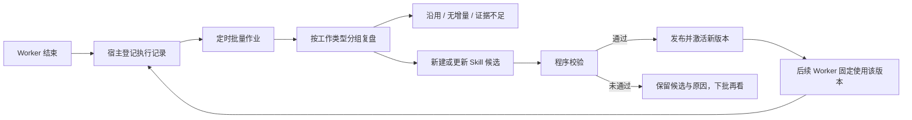

# Along 记忆与技能

> v0.5，2026-11-15。拟实现设计。依据见 [决策记录](000-decisions.md) 的 D6、D7、D10、D13。

## 1. 三类积累分开保存

| 内容 | 回答什么 | 保存在哪里 |
| --- | --- | --- |
| 目标与运行状态 | 现在要做什么，进行到哪里 | `along.sqlite` 与 DSH Store |
| 用户长期记忆 | 这个人有什么长期偏好或事实 | Hy-Memory 提取与召回，`along.sqlite` 保存治理状态 |
| Skill | 同类工作下次怎样做得更好 | 技能版本库，带适用条件、证据和版本 |

「我喜欢晚饭前运动」是记忆；「根据剩余可用时段调整周运动安排」可以是 Skill。用户健康值、姓名、Token 和私人对话不进入 Skill 正文。

## 2. 记忆

### 2.1 记忆不是聊天历史，也不是任务状态

| 输入 | 怎样保存 |
| --- | --- |
| 「以后尽量安排在晚饭前运动」 | 长期偏好，有原消息证据 |
| 「今天改到晚饭前」 | 今日任务调整，有到期边界，不进长期记忆 |
| 「这次训练每周最多三次」 | 当前目标的约束，写在目标里；不扩展到其他目标 |
| 多次没有晨跑完成回执 | 行为记录或待验证假设，不能推断为「讨厌晨跑」 |
| Agent 自动安排了晚上跑步 | 系统生成的安排，不是用户偏好的证据 |

### 2.2 哪些即时生效，哪些批量处理

记忆提取是批量的（D7），但用户刚说的话必须立刻起作用：

- **即时**：当前目标的约束由 Worker 写进目标和任务；近期对话直接进入上下文。两者都不依赖记忆提取。
- **即时**：用户要求删除或撤回某条记忆，治理状态立即置为撤回，检索立即排除。
- **批量**：从对话中提取跨目标的长期偏好与事实、合并、处理冲突、清理已撤回内容在 Hy-Memory 中的数据与索引。

「忘记这件事」不删除历史聊天（D13）。原文保留供用户查看；撤回记录需要关联来源与适用范围，Context Builder 和批量提取均需核对。保留原文不能成为继续使用该记忆或再次提取、激活它的依据；已有阶段摘要也不能绕过撤回状态。

### 2.3 写入与读取规则

1. 记忆候选绑定原消息或事件，校验所属用户、适用范围、表达主体、时间和证据。引用他人的话、假设句、否定句不是用户事实。
2. 明确且无冲突的表达成为有效记忆；推断保持 `candidate`，不升级为事实。
3. 新表达更正旧偏好时，在同一范围内替代旧版本；范围或含义冲突不明时保留冲突，必要时询问。
4. 读取返回内容、状态、来源、范围、有效期与版本，默认只用有效记忆。
5. 不能只用相似度或置信度解决冲突。记忆不能扩大 Mandate，也不能替代执行授权。

### 2.4 Hy-Memory 接入（第一期）

用 SDK，不引入 MemHub 等桌面产品。一个常驻 Python 进程封装 `HyMemoryClient`，Along 的 Memory Service（TypeScript）通过本机协议调用。Worker 只看到 Memory Service 的业务操作，不直接拿到 SDK。

起步配置（拟议，阶段 0 验证安装，阶段 D 验证质量）：

- `pro` 模式：需要事实提取与冲突处理，`lite` 只做原始内容检索，不够用。
- `scene="chat"`，本地 Chroma，`MEMORY_ENABLE_GRAPH=false`，`MEMORY_ENABLE_INTENTION=false`；不开 `ultra`、图式演化和本地重排模型。意图与计划由 Goal / UserTask 承载。
- 分别配置 LLM 与 Embedding 端点；不要求在 Mac 上部署专用记忆模型。
- 关闭图功能不等于去掉 Kuzu 依赖，Mac 上的安装需要实测。[配置说明](https://github.com/Tencent-Hunyuan/Hy-Memory/blob/main/docs/env_reference.md)、[依赖](https://github.com/Tencent-Hunyuan/Hy-Memory/blob/main/pyproject.toml)。
- 固定 SDK 版本，不照抄 README 示例里的版本号。

边界：

- **身份与范围由 Along 绑定**：使用稳定的用户 ID 与 Along Agent 身份，不用每次变化的 Worker Session ID。`goal_id`、消息 ID 等放在 `meta`（`metadata` 不保证保存），但 `meta` 不提供授权或过滤，召回后按治理状态与范围再核对。[使用约定](https://github.com/Tencent-Hunyuan/Hy-Memory/blob/main/docs/usage.md)
- **SDK 落库不等于有效记忆**：`add()` 会直接推进提取与 reconcile。适配器把结果纳入 SQLite 治理，通过 §2.3 检查后才作为有效记忆提供给规划；合并或更正出的新内容不沿用旧内容的状态。
- **故障降级**：Hy-Memory 超时或失败时保留待处理项，规划读 SQLite 中已有的有效记忆；关键上下文仍缺时询问或等待，不补成事实。业务接收与结果交付不被记忆处理阻塞。
- **不把健康数值当长期特征**，高频健康摘要不送去提取偏好。

### 2.5 阶段 D 的质量门槛

用同一组中文业务用例，在实施前写下通过标准：

1. 明确偏好、临时约束、否定与引用能正确区分；助手的建议不变成用户事实。
2. 通用偏好跨目标复用，目标专属约束不污染其他目标；召回不足时不扩大范围。
3. 撤回后，旧事实、画像、摘要和索引都不能作为有效记忆使用；历史聊天仍可查看，但装配上下文、重启、重新提取旧聊天或重处理旧事件均不能使该记忆复活。
4. 重试与部分写入：适配器保存逻辑操作与每次尝试的映射，不把 SDK 的 request id 当作业务事件的唯一保证。
5. 本地代价：常驻内存、提取与检索延迟、模型调用量、重启和备份恢复。

达不到门槛时先调配置和模型；运行中出故障按 §2.4 降级。

## 3. 技能

### 3.1 执行记录：Worker 结束时不调模型

Worker 结束（成功、失败或中断）时，宿主确定性地登记执行记录：Assignment、触发事件、使用的 Skill 版本、工具轨迹引用、结果与 ChangeSet。进程崩溃时由恢复流程补登。之后的用户反馈（纠正、完成回执）通过 WorkLink 关联到这条记录，供复盘使用。

### 3.2 批量复盘

每条执行记录都有复盘去向：创建、更新、沿用、无可复用增量或证据不足。按工作类型分组，一批调用一次模型，不按 Worker 次数调用。

### 3.3 自动发布与回退

- **发布条件**：程序检查可加载格式、适用范围、重复或冲突、内容边界；方法要有同类工作中多次成功的执行记录支撑，单次成功只记为候选。具体次数在阶段 E 定。
- **版本固定**：每次派工固定并记录使用的 Skill 版本；新版本不热替换正在运行的上下文。
- **自动回退**：发布后若该类工作被用户聊天纠正的比例、或 ChangeSet 被校验拒绝的比例明显上升，批量作业自动停用新版本、回到上一版本，并记录依据。
- 不设人工审核（D10）；失败经验可以形成带证据的适用限制，但不能写成已验证的方法。
- 首期只在本地个人空间复用，不做技能市场。

原型的 `bindSkills` 会随提示词版本更新注册内容，不等于已支持「按 Assignment 固定版本」。候选、校验、版本选择、发布与回退都是新增工作。

## 4. 定时批量作业

- **一个作业，固定顺序**：补登缺失的执行记录 → 记忆提取与清理 → 复盘与 Skill 整理 → 回退检查。
- **周期**：默认每天一次（本地夜间），待处理记录积压超过阈值时提前运行。具体值阶段 E 定。
- **错过补跑**：Mac 休眠或关机错过时，启动或唤醒后发现上次成功运行早于一个周期就补跑一次，不按错过次数重复跑。
- **幂等与恢复**：按执行记录和批次去重，状态存在 `along.sqlite`，重启后从断点继续，不重复生成版本。
- **不影响交付**：作业失败不影响用户结果，也不会重复执行原任务。
- **调度方式**：阶段 0 选用 DSH 进程内计时器，任务到期时间、批次与断点存在 `along.sqlite`；启动和周期检查时按当前时间核对是否漏跑，只恢复已有批次或补跑一次。进程内禁止重叠运行，不新增独立 launchd 作业。原型 `src/` 中尚无这套调度器，实现与休眠补跑验收仍在阶段 E。
