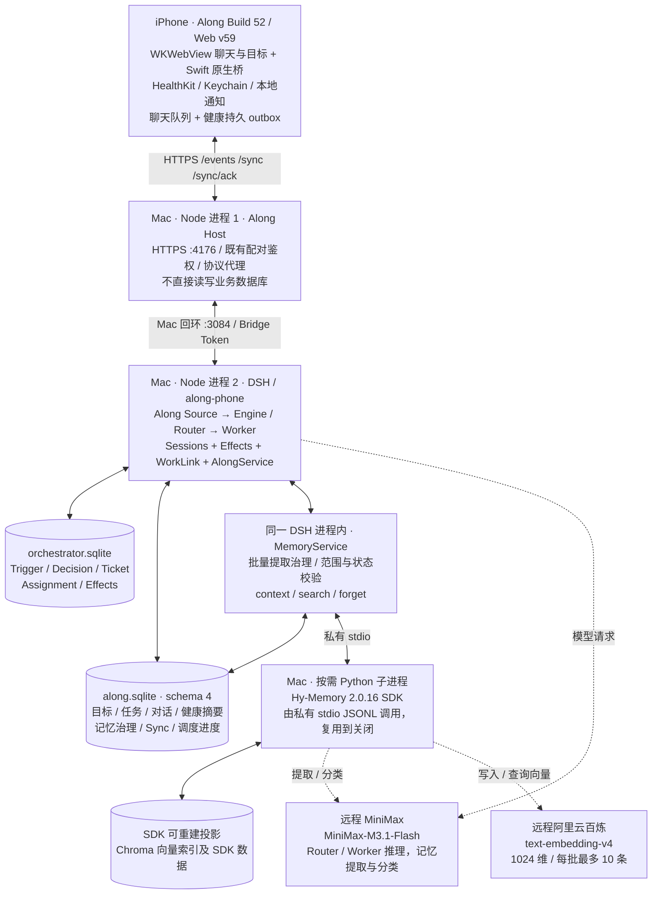
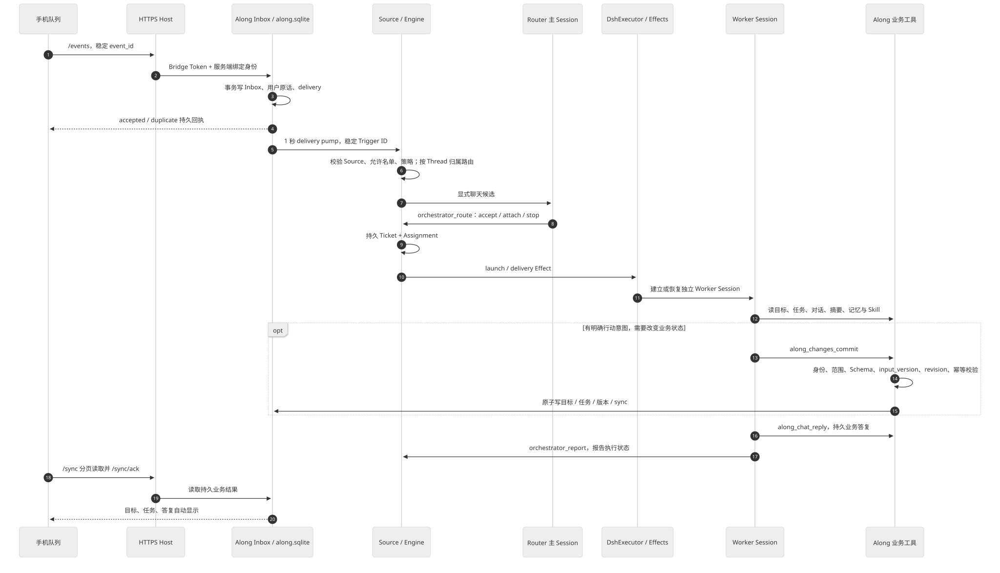
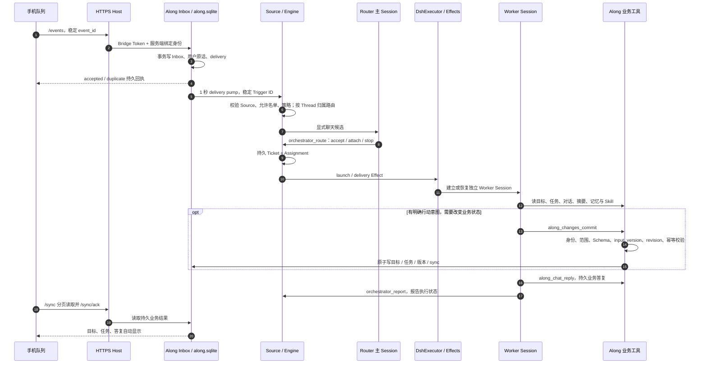
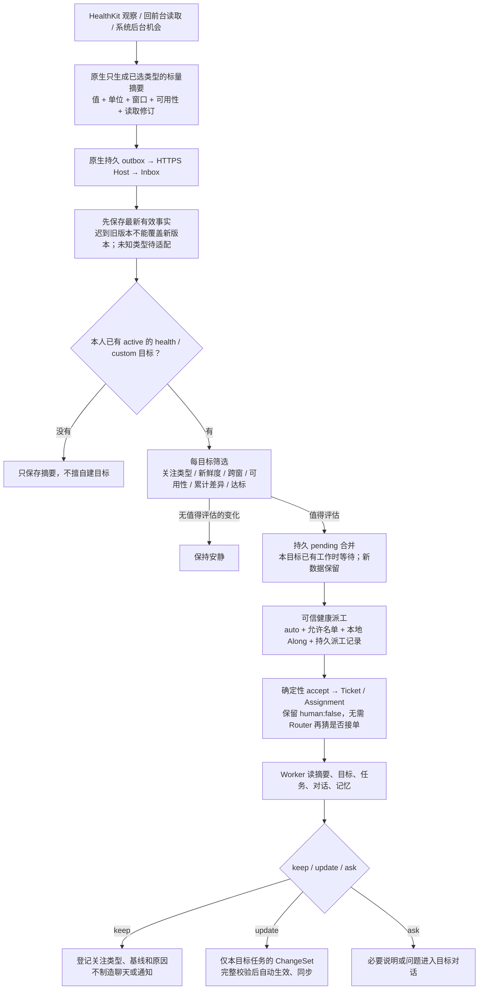
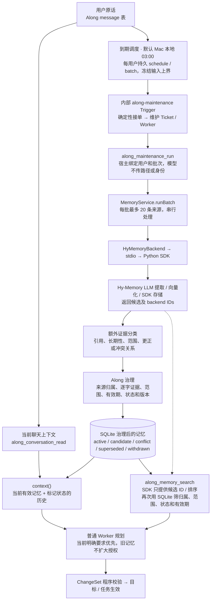
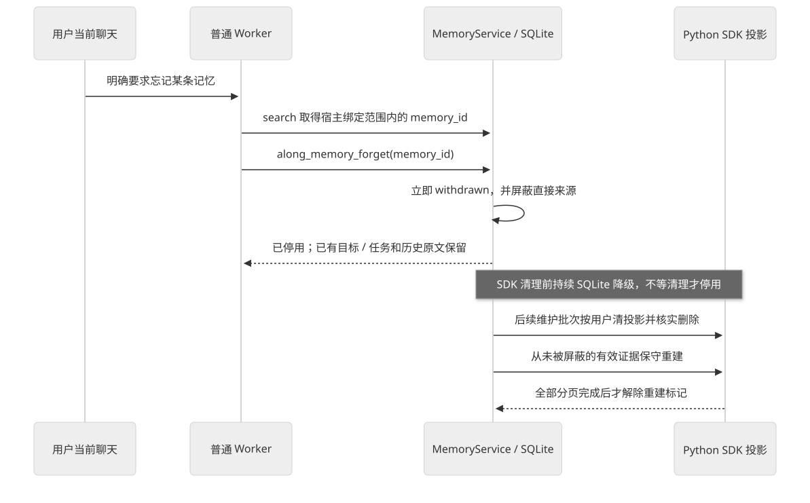
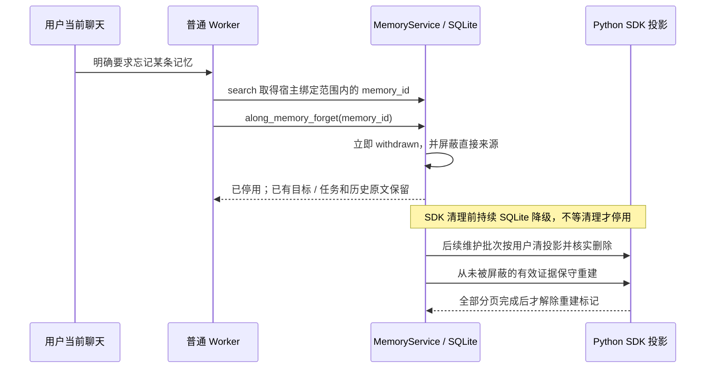

# 当前 Along：进程、派工与长期记忆

核对日期：2026-11-16。本文说明**当前代码如何运行**，与 [001 目标架构](001-architecture.md) 中的后续设计分开。代码基线：Along Agent `cdbac6d055d9ea053e454820072a4874b1552335`；配套 iPhone / Host 工程 Along `07aa7489ce0ed582d3a0aca7c668d444fc60e9e0`（Build 52 / Web v59）。

主分类：`release`，依赖上述两个仓库主线。可观察验收：手机能连接新版 Host；读者能沿图找到聊天、健康跟进、记忆提取、记忆召回分别由谁触发、读写哪里、何时生效。

**名称先校准：仓库没有接入 MemHub 桌面产品。接入的是 Hy-Memory 2.0.16 的 Python SDK。** [记忆方案](002-memory-and-skills.md) 明确选择 SDK、不引入 MemHub。下文“记忆模块”指 Along MemoryService + Hy-Memory SDK + Along SQLite 治理层。

## 1. 系统部署：手机、两个 Node 进程、一个按需 Python 进程

查看 Mermaid 源码

端口是本次部署实例：DSH 选 `3084`，以避开本机已有 profile；启动器默认是 `3082`。手机只访问 Host，DSH 管理面板和业务 Bridge 都在回环地址。Host 不直接读写业务数据库。

本地服务不等于本地模型：必要聊天上下文和获准摘要会发送到所配置的远程 LLM；记忆提取来源与检索查询也会经相应 LLM / Embedding 服务处理。原始 HealthKit 样本仍在手机。

## 2. DSH Agent 怎么 run：Router、Engine、Worker 各做什么

它是 DSH 的插件 bundle（包名 `dsh-superagent`），不是每条消息启动一个独立 DSH 服务。`Runtime` 在一个长期运行的 Node 进程中装配业务模块，DSH Session 承载模型会话；Worker Session 不等于新的操作系统进程。

查看 Mermaid 源码

| 模块 | 实际职责 | 不能混为一谈的边界 |
| --- | --- | --- |
| Along Source | 描述接收的事件、范围和用户准入 | 不负责业务规划，也不因收到事件就修改目标 |
| Engine | Trigger、Thread、Eval、Decision、Ticket、Assignment 的确定性状态机 | 不直接生成用户的运动或睡眠安排 |
| Router 主 Session | 对聊天做接单、关联在途工作、停止等路由 | 有聊天工单不等于必须建立 Goal；现象也要得到回应 |
| DshExecutor / Sessions | 并发槽、Worker 创建与恢复、工具和 Prompt/Skill 装配、后续输入投递 | 一个 Ticket 可有多次 Assignment；本次配置最多 3 个 Worker |
| Worker | 理解语义，读取真实业务状态，提出结构化变更和答复 | 模型输出不是数据库写入授权，写入仍须通过程序校验 |
| WorkLink | 把工单和服务端用户 / 目标 / 输入版本绑定 | Worker 不能凭参数任意换用户或换目标 |
| AlongService | 接收事件、校验 ChangeSet、保存业务事实和同步结果 | Goal / UserTask 是用户业务对象，Ticket 是 Agent 执行对象 |

用户说“最近睡得不好”可只得到回应；说“我想改善睡眠，先从睡前放下手机开始”才可能创建目标和任务。通过校验的 ChangeSet 自动生效，不再等待“采用”；用户通过聊天纠正。只读协调工具可看本人其他目标的安排，但不扩大写入范围。

DSH 的正常恢复依赖持久数据库与会话记录。delivery pump 每秒投递；Runtime 的周期 pass 每 2 秒推进到期工作和 Effect，新输入也可立即请求 pass。手机收到事件回执、Worker 完成、业务生效、手机同步完成是四种不同证据。

## 3. 健康变化：先存事实，再决定是否值得唤醒

查看 Mermaid 源码

七类固定调度去重阈值：步数 500、运动 5 分钟、活动消耗 50 千卡、体重 0.1 千克、静息心率 3 次/分、手腕温度 0.1°C、睡眠 15 分钟。它们用于减少重复派工，**不是医学判断**；跨窗、可用性变化和结构化目标达标另外处理。小变化相对上次实际评估的基线累计，不是每次读取都清零。

健康 Worker 不能创建、改写或归档用户目标。用户新聊天会使旧健康工作提交失效；工作进行期间到达的新摘要留给下一轮。iOS 是否唤醒、锁屏时能否读到健康数据、Mac 是否在线，都不能由 DSH 保证。普通 keep 静默。当前到期提醒或需要用户处理的回复通过既有同步项附带通知意图；投递能力与实际送达由 Host 和客户端分别核实。

## 4. 记忆怎样接入、何时生效

这里有两条不同的时间线：**聊天立即进入当前业务对话，Worker 当轮可读；长期记忆主要在夜间批次提取后生效。** 当前实现没有“每次聊天后立即提取长期记忆”的钩子。

查看 Mermaid 源码

**生效不是“把向量库全文塞进 Prompt”。** 普通 Worker 有两条读取路径：

1. `along_conversation_read` 调用 `MemoryService.context()`，在对话之外返回当前 `memories` 和带状态的 `memory_history`；不依赖必须显式调用 search。
2. `along_memory_search` 做语义召回，SDK 返回 ID 后，宿主只输出 SQLite 中归属正确、范围适用且有效的治理记录。SDK 不可用、撤回清理未完成或投影仍在重建时返回 `degraded:true`，降级读取 SQLite 有效记忆。

例：原话“以后尽量晚饭前运动”可形成长期偏好；“今天改到早上”影响今天的任务，不应覆盖长期偏好；明确“更正，以后都早上运动”可让旧版本成为 `superseded`。引用他人、假设、否定、助手建议与健康数值不能直接变成本人的长期肯定偏好。模型候选即使成功写入 SDK，也可能被治理拒绝。

查看 Mermaid 源码

更正与忘记不同：更正保留可理解的新旧版本；忘记立即停用对应记忆及直接来源，但不截断全部旧聊天。当前实现不承诺精确清除模型曾经读过的所有派生摘要和上下文。

## 5. 定时维护与恢复

定时维护复用 DSH 的 Ticket / Assignment / Worker，不是另起一个 cron 进程。由 Runtime 既有 pass 检查持久到期时间；Mac 休眠漏跑后合并补一次，未完成批次优先续跑。

维护 Worker 仅有 `along_maintenance_run` 和报告工具，不能写目标、任务、手机聊天，也不能使用文件、Shell、网络或子 Agent 工具。每次宿主调用最多处理 5 页、每页最多 20 条；后来的聊天留给下一批。SDK 失败保留 pending 和退避时间，重试同一工单；没有待处理来源时不启动 Worker。暂停、名单移除和人工停止仍有效。

`alongMaintenanceTime: "03:00"` 可通过 DSH 现有配置表单修改。它按 **Mac 本地时区**计算；本次 Mac 为北京时间。首次装配初始化下一次执行时间，配置成功不等于已真实跨夜执行。

## 6. 数据与配置归属

| 所在位置 | 保存什么 | 谁拥有写权限 / 用途 |
| --- | --- | --- |
| iPhone HealthKit | 原始健康样本 | iOS 系统；Along 只读用户选中的类型 |
| iPhone Keychain | 手机到 Host 的既有配对信息 | 原生桥；升级保留 |
| iPhone 本机队列 / Web 缓存 | 待发聊天、原生健康 outbox、同步视图；旧版数据仍保留 | 手机可靠补传和离线展示 |
| `orchestrator.sqlite` | 执行与编排状态、设置、持久 Effect | DSH Store / Engine |
| `along.sqlite` | 业务事实、版本、记忆治理、同步与维护进度 | DSH 内 AlongStore，单写者 |
| SDK 数据目录 | 向量及 SDK 提取结果等可重建投影 | Python owner，排他锁 |
| Mac 0600 凭证文件 | 模型 Key、记忆服务配置、Bridge Token | 各宿主读取，不发给手机或放进业务结果 |

Along 数据目录与 Worker 工作目录必须分离，启动时检查。但普通 Worker 仍是同一个 macOS 账号，目录分离和工具名单不是操作系统安全沙箱，不应声称能抵御同账号任意代码读取。

本次安装启用新服务端空间，**旧版手机目标没有自动导入新库**。旧数据原位保留并做独立备份；SQLite schema 升级是新协议数据库内部迁移，不能代替旧手机目标迁移。完整恢复、Skill 自动发布 / 回退、完整复盘也不能画成已经上线的能力。

## 7. 代码定位

| 看哪条链 | Along Agent 代码 | 配套 Along 工程 |
| --- | --- | --- |
| 装配与启动 | [`runtime.ts`](../../src/app/runtime.ts)、[`deployment.ts`](../../src/deployment.ts)、[`cordis.patch.yml`](../../cordis.patch.yml) | `tools/activate.mjs`、`host/agent-host.mjs` |
| 手机接入 / 可靠投递 | [`api.ts`](../../src/along/api.ts)、[`inbox.ts`](../../src/along/inbox.ts)、[`delivery.ts`](../../src/along/delivery.ts)、[`sources/along.ts`](../../src/sources/along.ts) | `host/along-bridge.mjs`、`web/event-workspace.mjs`、`web/event-queue.mjs` |
| 路由 / 派工 / 模型 Session | [`core/engine.ts`](../../src/core/engine.ts)、[`tools/main.ts`](../../src/app/tools/main.ts)、[`executor/dsh.ts`](../../src/executor/dsh.ts)、[`sessions.ts`](../../src/app/sessions.ts) | 手机只展示业务答复与状态 |
| 业务自动生效 / 版本绑定 | [`tools.ts`](../../src/along/tools.ts)、[`worklink.ts`](../../src/along/worklink.ts)、[`changeset.ts`](../../src/along/changeset.ts)、[`store.ts`](../../src/along/store.ts) | `web/event-workspace.mjs` |
| 健康筛选与基线 | [`health.ts`](../../src/along/health.ts)、[`health-store.ts`](../../src/along/health-store.ts)、[`health-schema.ts`](../../src/along/health-schema.ts) | `HealthKitReader.swift`、`HealthModels.swift`、`HealthEventDelivery.swift` |
| 记忆治理 / SDK 适配 | [`service.ts`](../../src/along/memory/service.ts)、[`store.ts`](../../src/along/memory/store.ts)、[`hy-client.ts`](../../src/along/memory/hy-client.ts)、[`tools.ts`](../../src/along/memory/tools.ts)、[`along-memory-service.py`](../../scripts/along-memory-service.py) | 手机没有独立 MemHub 进程或 Key |
| 夜间批次与恢复 | [`maintenance.ts`](../../src/along/maintenance.ts)、[`maintenance-store.ts`](../../src/along/maintenance-store.ts)、[`passes.ts`](../../src/app/passes.ts) | 不新增手机入口 |

更细的合同和历史成功 / 失败证据分别见 [阶段 A](005-phase-a-integration.md)、[阶段 B](007-phase-b-integration.md)、[记忆实施](006-memory-implementation.md)、[定时维护](008-scheduled-maintenance.md)，以及配套 Along 工程的 `docs/stage-c-tech-design.md`。这些记录中的合成验证不能代替真机后台验收。

供应商接口参考：[MiniMax OpenAI SDK](https://platform.minimax.io/docs/api-reference/text-openai-api)、[百炼 OpenAI Embedding 兼容接口](https://help.aliyun.com/zh/model-studio/embedding-interfaces-compatible-with-openai)。本次国内 MiniMax endpoint 实际认证通过；百炼按 1024 维、batch size 10 配置。

### 到期复查、每日委托与通知

Agent 从持久的任务时间选择已到期、所属目标活跃的未完成任务。复查和健康变化沿用同一目标的串行派工、授权和 Worker 完成回执。到期事件包含任务、版本、原定时间。Worker 读取当时可用的目标、对话及事实，时钟到期不能证明用户完成任务或手机上传了新摘要。缺少新事实可以保留安排或补问。重启和模型连接恢复后从原有记录继续；改期、取消和新输入使过时工单失效。

每日委托需要 Worker 引用该目标中用户明确授权每日安排的原话。保存该条证据与用户时区，复查时针对当前本地日历，只续排仍有效的任务。一次性安排、取消、完成或归档不再续排。跨越多日离线时只恢复到下一个未来时刻。Worker 可以根据新输入调整或撤回。

普通同步按原有消息/任务事件发送。需要立即告知的推荐或任务结果才在用户可见消息的 payload 内附 notification（event_id、kind、revision），重试沿用原消息身份。提醒时刻继续由当前任务的 scheduledAt 表达。手机与 Host 获取同一用户授权下的同步项。验收以脱敏工单、复查结果、跨日/重启回归和客户端实际通知分别核对。

用户聊天可在具体任务的 create 或 update.fields 中声明 repeat=daily/once。完成、取消、清空时刻或改为 once 会终止后续排程。已经授权的任务在普通 keep 后继续每日排程。旧任务仅在引用的用户指令与唯一一个已排程任务的 revision 有明确关联时补建委托。

到期后十分钟内，Agent 独立于模型工单，把 reminder_due 与原时刻写入该任务的 task_updated。该次事件的写入凭据与同步项同事务。Host 可据 iOS 的本地排程回执处理远程补偿。超过时限仍复查任务。到期工单仅在该目标已有监测类型或类型化健康指标时读取相关新摘要，演示理财不读取健康值。

### 目标 chat 与后台事件

当前消息来源边界见[聊天边界](011-conversation-boundary.md)。用户本人输入及其直接回复进入对话；执行收尾、日常补排和健康／到期更新只保留后台审计。推荐仍由任务结果和通知呈现。宿主验证的必要澄清仍可向用户提问。开发验收必须使用隔离身份与数据，不得借正式配对代发 user_message。
