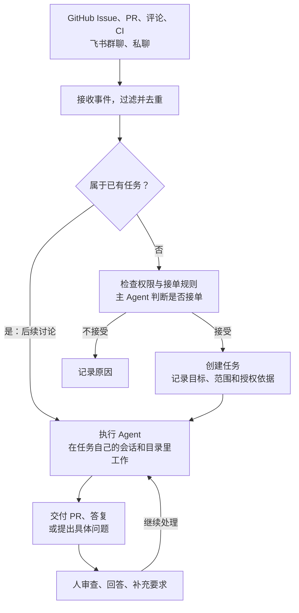

# GitHub / 飞书编程 Agent 功能概览

> 本文说明保留的编程 Agent 来源，适用于 GitHub / 飞书部署。Along 手机与 Mac 本地链路见[当前 Along 运行图](along/009-current-runtime.md)；全部入口见[文档导航](README.md)。

dsh-superagent 是一个替团队持续接活的编程 Agent。它关注一个 GitHub 仓库，也可以接入飞书，把符合权限和规则的请求变成任务，安排 Agent 执行，再把 PR、答复或需要人决定的问题送回原来的讨论里。

例如，你在 Issue 里说“修一下这个报错”，它可以接单、修改代码、运行检查、提交 PR。之后有人补充信息或提出修改意见，它还能接着处理。

本项目是运行在 DeepSeek Harness 上的研究原型，不是 DeepSeek 官方产品。下面依据仓库代码和文档说明功能，不代表已经完成真实 GitHub、飞书环境的联调验证。

## 一项工作怎么走完

图中省略了具体的接收范围和订阅条件。已有任务收到的后续消息只补充上下文，不扩大授权范围；超出范围的请求需要退回重新判断。

## 主要功能

| 功能 | 解决什么问题 | 当前实现 |
| --- | --- | --- |
| 接收工作 | 团队可以在日常讨论中交办任务 | 读取 GitHub 通知、Issue、PR、评审和 CI；飞书支持消息接收、历史补读和话题轮询。具体接收哪些事件由配置决定 |
| 判断是否接单 | 分清谁有权限、哪些工作可以做 | 按来源设置允许名单、接收范围、机器人名单和接单规则，并记录判断原因 |
| 分配执行 | 同时推进多项工作，保留各自的上下文 | 主 Agent 负责判断和调度；每个任务有自己的执行会话和工作目录，支持并发 |
| 持续跟进 | 提完 PR 后继续处理反馈 | 订阅相关讨论，把后续评论、评审和 CI 结果送给对应任务；超出原范围的请求退回重新判断 |
| 人工接管 | 让人看清哪里需要回答或决定 | 面板集中显示待回答、待审查、受阻和失败的任务，支持停止、重试、重新评估 |
| 保存与恢复 | 重启后保留任务记录，失败后有恢复路径 | 用 SQLite 保存任务、消息和决策；为中断任务提供恢复，为发送失败的消息安排重试 |

## 谁负责接单，谁负责干活

主 Agent 负责理解新请求、决定是否接单、分配任务和处理执行报告。执行 Agent 负责一项具体任务，例如读代码、修改文件、运行命令、检查结果和准备 PR。

任务在代码里叫 `Ticket`，一次派工叫 `Assignment`。两者分开记录，因此一项任务可以经历执行、等待评审、收到反馈和继续修改。某轮对话结束，并不代表任务结束。

后续消息优先交给负责该任务的执行 Agent。它判断请求是否仍在任务范围内；不属于这项工作的消息，会带着原因退回主 Agent。这样既能保留上下文，也能避免每条追问都变成新任务。

已结束、且没有被人主动停止的任务，可以在收到自身讨论中的人工消息后恢复，但需要重新验证原授权。机器人消息和 CI 不会唤醒已结束的任务。

## 明确交办与主动接单

系统区分两种工作来源：一是符合权限的人明确交办，二是 Agent 从收到的讨论或事件中判断出可能需要处理的工作。第二种受主动接单模式控制。

| 模式 | 对主动发现的候选任务怎么处理 |
| --- | --- |
| `off` | 不进入主动接单评估 |
| `observe`，默认 | 评估并记录“本来会接什么”，但不实际创建任务 |
| `auto` | 评估通过后创建任务并执行 |

符合权限的明确请求，在三种模式下都可以处理。`off` 只关闭主动接单，不等于暂停整个系统。

主动接单需要命中团队启用的规则，并具备明确的实施意图和目标。默认规则主要覆盖文案纠错，以及目标明确的局部视觉修复。仅仅说“这里不好看”，不足以让 Agent 自行决定如何重新设计。

授权会记录请求人、允许处理的范围、接单依据和策略版本。收到更多上下文，不会自动获得更大的权限。

## 人在面板里能看到什么

管理面板位于 DeepSeek Harness Web 的 Superagent 入口，按工作流程分成六个页面：

| 页面 | 主要用途 |
| --- | --- |
| 概览 | 先看哪些任务需要人处理，再看系统问题和执行负载 |
| 来源 | 查看 GitHub、飞书的接收状态、配置问题和异常 |
| 触发 | 查看收到的消息、所属讨论及其去向 |
| 评估 | 查看为什么接单、忽略或未能完成判断，以及命中的规则 |
| 执行 | 查看任务进度、授权范围、输入和派工记录，进行停止、重试等操作 |
| 设置 | 调整来源、接单规则、模型、并发数、提示词、技能和部署参数 |

团队可以编辑沟通方式、任务范围和交付要求，也可以覆盖内置提示词。提示词修改影响 Agent 收到的指令；权限准入、授权记录和工具检查仍由代码处理。

## 当前实现的边界

- 一套部署面向一个 GitHub 仓库，飞书是可选来源。它依赖 DeepSeek Harness 提供会话、模型调用和工具执行能力。
- 每个任务有独立目录，但目录本身不构成安全隔离。执行器以部署者的操作系统账号运行命令；按命令名设置的拦截也不是完整的安全边界。
- 创建任务目录不等于已经检出代码。可以配置准备命令，例如通过 `git worktree` 创建工作副本；未配置时，执行器从空目录开始。
- 默认由人合并 PR。自动合并需要在交付要求中指定其他账号的 CLI，并满足相应条件；这些合并条件主要由提示词约束，仓库保护规则需要在 GitHub 中配置。
- 暂停处理会停止新评估、派工、输入投递和回复，但来源继续记录事件，已经运行的执行轮次也不会被立即打断。
- 持久化、去重和重试提供恢复机制，不保证所有外部操作只发生一次。重启恢复指令会要求执行器先检查目录、Git 历史和 GitHub 状态，再决定是否重复操作。

## 从哪里继续读

| 想了解什么 | 文档或代码 |
| --- | --- |
| 为什么强调少打扰人 | [设计原则](000-philosophy.md) |
| 消息、任务、授权之间的关系 | [领域模型](001-domain.md) |
| 哪些人、哪些事件可以启动工作 | [授权规则](002-authorization.md)、[策略实现](../src/policy.ts) |
| 并发执行、等待、重试和恢复 | [执行机制](003-execution.md)、[执行器实现](../src/executor/dsh.ts) |
| 怎样调整 Agent 的工作方式 | [提示词配置](004-prompts.md) |
| 面板中的状态和操作 | [管理面板](005-panel.md) |
| 怎样安装、配置和排查问题 | [部署说明](006-deployment.md)、[安装引导](../SETUP.md) |
| 模块如何连接，代码放在哪里 | [整体架构](007-architecture.md)、[运行时组装](../src/app/runtime.ts) |
| 怎样接入新的事件来源 | [扩展来源](008-cookbook.md) |
